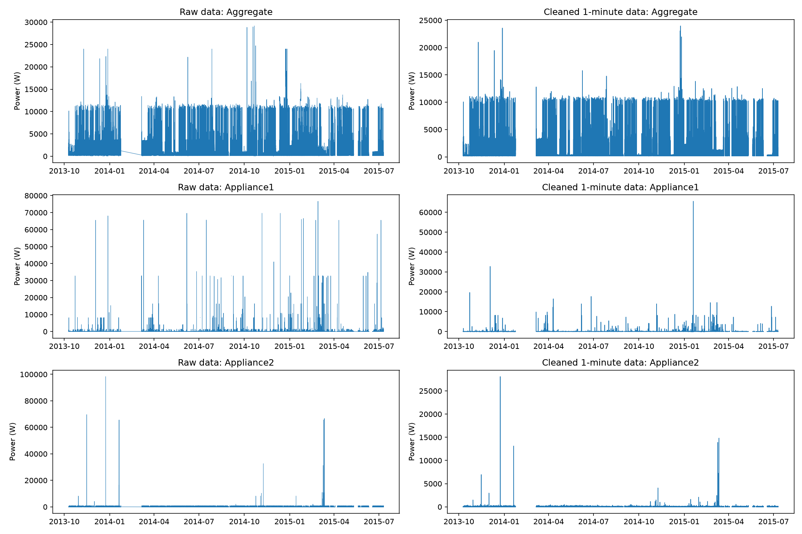
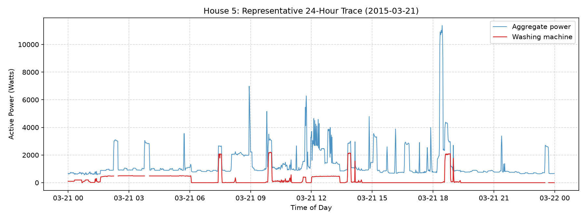
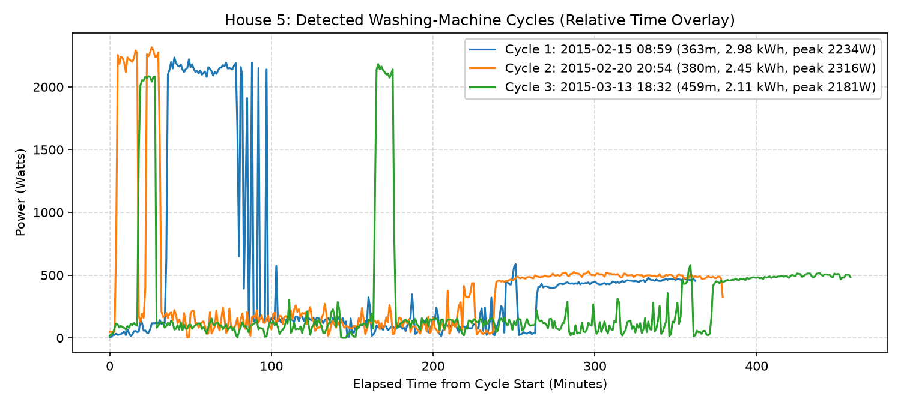
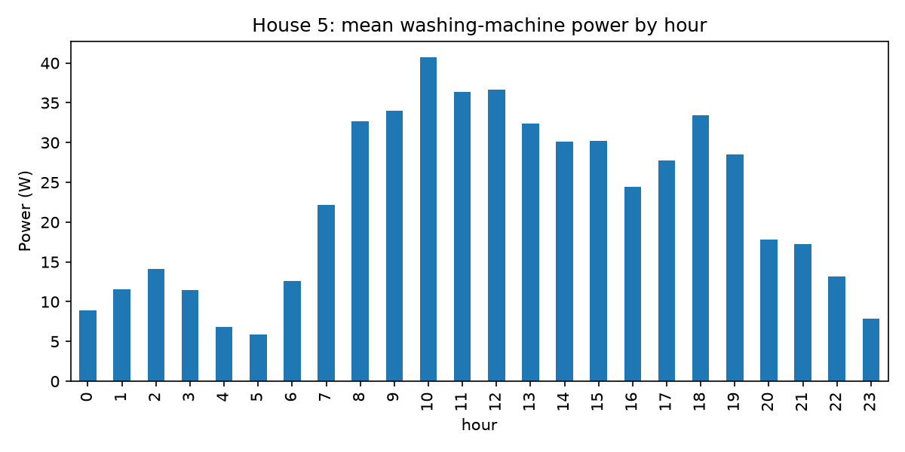
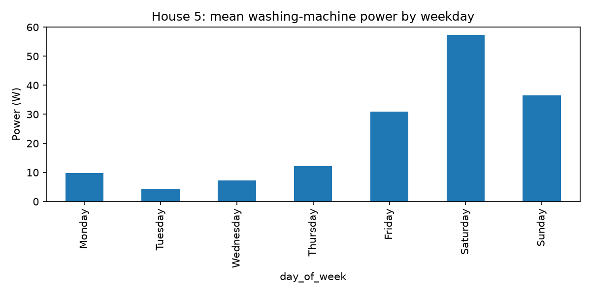
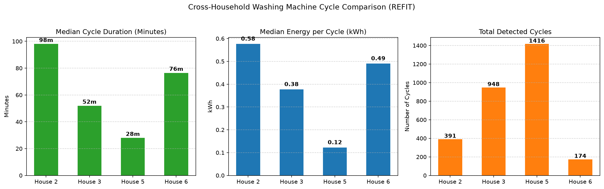
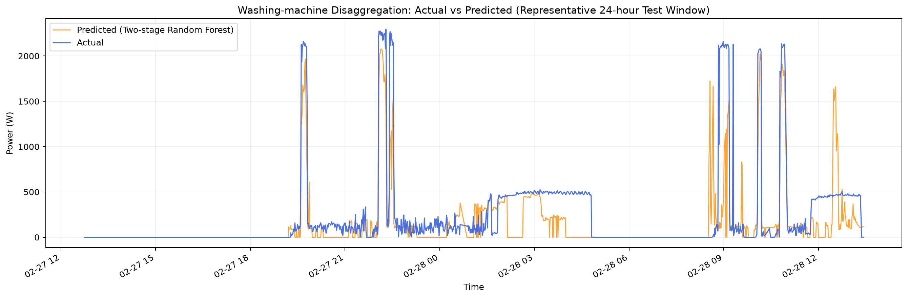

# RESULTS — House 1 cleaning, washing-machine EDA and appliance disaggregation

## 1. House 1 Data Cleaning

### Scope and raw-data inspection

House 1 was used for the raw-to-cleaned data-preparation exercise. The two raw House 1 parts were combined for inspection before producing the one-minute dataset. The original combined data contained **8,518,763 rows**, spanning **2013-10-09 14:06:17 to 2015-07-10 11:56:32**.

The timestamp inspection found **0 invalid timestamps**, **761,551 duplicate timestamps**, a **7-second median sampling interval**, **3,581,302 irregular intervals**, and **1,040,974 long-gap intervals**. These figures describe the timestamp-level inspection; irregular intervals and long gaps are not necessarily independent records or separate faults.

### Cleaning approach

The House 1 cleaning workflow applies the following steps:

1. Parse timestamps and combine the two raw data parts into a consistent time series.
2. Inspect and handle duplicate timestamps before resampling.
3. Resample numeric power channels to a one-minute frequency using the mean within each minute.
4. Treat negative power readings as invalid and mask them rather than interpreting them as consumption.
5. Interpolate only short internal gaps, up to three consecutive one-minute intervals. Longer gaps and gaps at the beginning or end of a series remain missing.
6. Retain and inspect unusually high readings rather than automatically deleting every high value. I flagged readings above **4,000 W** for investigation; the threshold is a review rule, not an automatic deletion rule.

I kept the last record when duplicate timestamps occurred. Negative power readings were replaced with missing values. For resampling, I used the one-minute mean of available power readings and excluded the `Unix` field because it is timestamp-related rather than a power measurement.

After duplicate removal, **7,757,212 rows** remained. No negative readings were found in any of the ten power columns. Readings above the configured **4,000 W** threshold were flagged for investigation rather than removed: the aggregate channel had **41,054** such readings, while the appliance channels had between **36 and 2,085** each.

After one-minute resampling, the House 1 dataset contained **920,031 rows**. Before short-gap interpolation, missing counts ranged from **115,121** in Appliance7 to **212,969** in Appliance9. Interpolation reduced these counts, but missing values remained: there were **215,381 timestamps with at least one power channel missing**, including **114,382 timestamps where all power channels were missing**. Missing values are not automatically converted to zero because an unobserved reading is not evidence of zero consumption.

### Before-and-after comparison

The figure below compares the raw readings with the cleaned one-minute readings for the aggregate channel and two appliance channels (Appliance1 and Appliance2). The same channel is shown before and after cleaning so that changes in sampling frequency, gaps and extreme readings can be inspected.

The cleaned series is a one-minute representation of the source readings, not a guarantee that every remaining extreme value is valid. The plots show that large peaks remain in some channels after resampling. These should be treated as flagged observations for further source-level investigation, not silently removed or described as corrected unless the cleaning code explicitly removes them.

### Cleaning outcome and limitations

Resampling standardises the time axis and makes the data suitable for minute-level analysis, while limited interpolation fills only short internal gaps. It does not reconstruct long outages, prove that extreme readings are genuine, or resolve all sensor-quality problems. The missingness and timestamp irregularity therefore remain important limitations in later analysis.

---

## 2. Washing-machine EDA
The EDA uses one-minute cleaned REFIT data from Houses **2, 3, 5 and 6**. Their respective periods are:

- **House 2:** 2013-09-17 22:08 to 2015-05-28 08:05

- **House 3:** 2013-09-25 19:21 to 2015-06-02 10:55

- **House 5:** 2013-09-26 09:56 to 2015-07-06 17:48

- **House 6:** 2013-11-28 12:15 to 2015-06-28 22:14

The household-specific washing-machine channel mapping and missing-data quality report are documented in [DATA.md](DATA.md).

### Event definition
A washing-machine reading of at least **5 W** is considered active. A detected event must contain at least **5 consecutive active minutes**. Off-gaps of up to **3 minutes** are merged when they occur within a continuous known-data segment. Missing observations break an event and are not treated as zero. This simple rule suppresses very short isolated readings and joins brief interruptions, while remaining easy to explain. The resulting events are operationally detected usage events, not confirmed physical wash programmes. The event counts depend on these chosen parameters.

### Cross-house results
| House | Missing washing-machine data | Off time among valid readings | Detected events | Median duration | Median energy per event |

|---|---:|---:|---:|---:|---:|

| 2 | 24.70% | 94.54% | 391 | 98 min | 0.576 kWh |

| 3 | 15.38% | 94.41% | 948 | 52 min | 0.377 kWh |

| 5 | 13.25% | 92.07% | 1,416 | 28 min | 0.122 kWh |

| 6 | 15.35% | 98.10% | 174 | 76.5 min | 0.490 kWh |

House 5 has the largest detected event count and the lowest median event energy in this comparison. House 6 has the highest off-time percentage and the fewest detected events. House 2 has the greatest washing-machine missingness, which reduces the amount of usable evidence for its usage profile. These comparisons are descriptive and should be interpreted in light of different observation periods, missingness and household-specific behaviour.

### Usage-pattern plots
The pipeline generates hourly and day-of-week usage profiles, weekday-versus-weekend summaries, a representative 24-hour aggregate-plus-washing-machine trace, examples of detected events, and a cross-house cycle comparison. Include the generated figures in the submitted repository (for example, under \`docs/assets/\`) and retain their original titles/axes. Add a short caption below each figure explaining the pattern visible in that specific plot. Do not claim a peak hour or weekday effect unless it is supported by the corresponding generated plot.

## 3. Washing-machine disaggregation
### Scope and split
The model experiment uses **House 5**, with household aggregate power as the input and its washing-machine (\`Appliance3\`) power as the target. Both are at one-minute resolution. The full available series spans 2013-09-26 09:56 to 2015-07-06 17:48.

A chronological holdout was used:

| Split | Rows | Period |

|---|---:|---|

| Training | 640,000 | 2013-09-26 10:11 to 2015-02-16 19:24 |

| Test | 160,001 | 2015-02-16 19:25 to 2015-07-06 17:48 |

This preserves temporal order: the test period occurs after the training period. It avoids randomly distributing adjacent/overlapping time observations between training and test sets. Candidate activity thresholds were selected using an internal chronological validation segment drawn from the outer training data; the final test period was not used for that selection.

### Features and models
The feature set uses aggregate power at the current minute and historical lags/rolling summaries, together with time-of-day and day-of-week encodings. Only current and past aggregate readings are used, avoiding future-looking input features.

The evaluated approaches were:

- Always-off baseline (predict zero washing-machine power at every minute).

- Random Forest regression.

- LightGBM regression.

- Two-stage Random Forest: an activity classifier followed by a power regressor for predicted-active observations.

The activity threshold was selected from 5, 10, 20 and 30 W using the highest F1-score on internal chronological validation. **5 W** was selected. This threshold defines the operational activity label; it is not independently verified physical ON/OFF ground truth.

The validation results for the candidate thresholds were:

| Threshold (W) | Precision | Recall | F1-score |
|---:|---:|---:|---:|
| 5 | 0.337 | 0.451 | 0.386 |
| 10 | 0.308 | 0.452 | 0.367 |
| 20 | 0.304 | 0.488 | 0.375 |
| 30 | 0.281 | 0.470 | 0.352 |

I selected **5 W** because it gave the highest validation F1-score (**0.386**) among the four candidates. These are internal validation metrics; the test-set activity metrics reported below are a separate final evaluation.

### Test-set model comparison
| Model | MAE (W) ↓ | RMSE (W) ↓ | Actual energy (kWh) | Predicted energy (kWh) | Absolute energy error (kWh) ↓ |

|---|---:|---:|---:|---:|---:|

| Always-off baseline | 32.09 | 190.33 | 85.59 | 0.00 | 85.59 |

| Random Forest | 34.51 | 159.59 | 85.59 | 53.27 | 32.31 |

| LightGBM | 37.28 | 162.29 | 85.59 | 46.07 | 39.52 |

| Two-stage Random Forest | 35.45 | 168.28 | 85.59 | 75.58 | 10.01 |

The two-stage Random Forest was selected because it has the smallest absolute total-energy estimation error among the evaluated machine-learning models. It estimated **75.58 kWh** against **85.59 kWh** actual, giving an absolute difference of **10.01 kWh** (approximately **11.69%** of actual test energy). Random Forest had the lowest RMSE among the evaluated approaches and the lowest MAE among the trained machine-learning models. The always-off baseline had the lowest MAE overall because most one-minute observations were zero; however, it estimated no energy and had the largest total-energy error. Therefore, MAE alone would give a misleading impression of usefulness for this highly sparse target.

### Activity detection
For the selected two-stage model on the test set:

| Metric | Result |

|---|---:|

| Precision | 0.553 |

| Recall | 0.436 |

| F1-score | 0.487 |

| Actual active minutes (5 W threshold) | 17,565 |

| Predicted active minutes | 13,831 |

The model identifies activity with moderate performance. Precision of 0.553 means that a little over half of its predicted-active minutes were active under the chosen label definition. Recall of 0.436 means that it detected less than half of the actual active minutes. The validation threshold-tuning F1 values are separate from the final test F1 and should not be conflated.

### Actual-versus-predicted interpretation
The generated \`actual_vs_predicted.png\` plot compares the actual washing-machine signal with the selected two-stage Random Forest on the test data. The displayed segment is dominated by zero/low-power periods and contains a small number of sharp operating events. The model captures some high-power activity but does not reproduce every event's timing and magnitude accurately. The plot is a segment-level illustration; the metrics above are calculated across the full 160,001-row test set.

### Failure cases and limitations
1\. ****Missed or underestimated high-power events:**** some observed readings above 2,300 W are predicted substantially lower, and at least one of the largest observed events has a zero prediction. The model can therefore miss short or unusual operating phases.

2\. ****Sparse target and overlapping loads:**** most minutes have zero washing-machine power. Aggregate household demand combines multiple appliances, so similar aggregate patterns can correspond to different appliance-level states. This makes activity detection ambiguous.

3\. ****Missing appliance observations:**** the House 5 washing-machine channel has 13.25% missing one-minute readings after quality filtering. Missing target readings are not treated as zero, but data gaps still reduce usable training/evaluation information and may obscure event boundaries.

4\. ****Household-specific evaluation:**** the disaggregation model was trained and tested on House 5 only. The result does not establish generalisation to other households, appliance models or countries.

## 4. Overall interpretation
The experiment demonstrates a reproducible baseline and several explainable tree-based approaches for estimating washing-machine load from aggregate household demand. The two-stage Random Forest gives the closest total-energy estimate, while minute-level activity detection and power reconstruction remain imperfect. The results are best interpreted as an exploratory estimate of appliance usage, not a verified sub-meter measurement or billing-grade disaggregation system.

---

## 5. Visual Analysis and Model Evaluation
### 5.1 Representative 24-Hour Usage — House 5
The following plot compares household aggregate power consumption with washing-machine power consumption over a representative 24-hour period.

### 5.2 Detected Washing-Machine Cycles
Operating cycles were identified using a 5 W threshold, a minimum active duration of 5 minutes, and merging inactive gaps of up to 3 minutes within valid data segments.

These are algorithmically detected operating events, not independently verified wash programmes.

### 5.3 Hourly Usage Pattern

This plot illustrates how washing-machine usage varies throughout the day.

### 5.4 Day-of-Week Usage Pattern

This plot compares washing-machine usage across days of the week.

### 5.5 Cross-Household Comparison
The following plot compares washing-machine cycle characteristics across Houses 2, 3, 5 and 6.

### 5.6 Actual vs Predicted Washing-Machine Power
The following plot compares actual washing-machine power with predictions from the Two-stage Random Forest model on the chronological test set for House 5. It shows a representative test window containing multiple washing-machine operating events.

The model captures some washing-machine operating events but does not consistently reconstruct the actual power profile. It underestimates several high-power peaks and produces false activity predictions during some periods when actual washing-machine consumption is close to zero. Although its point-wise predictions remain imperfect, its total estimated energy is relatively close to actual consumption, with an absolute error of 10.01 kWh (11.69%). This highlights the difference between estimating total energy accurately and reconstructing individual appliance power readings accurately.
