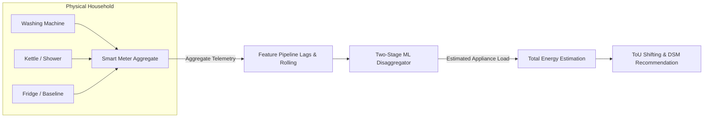
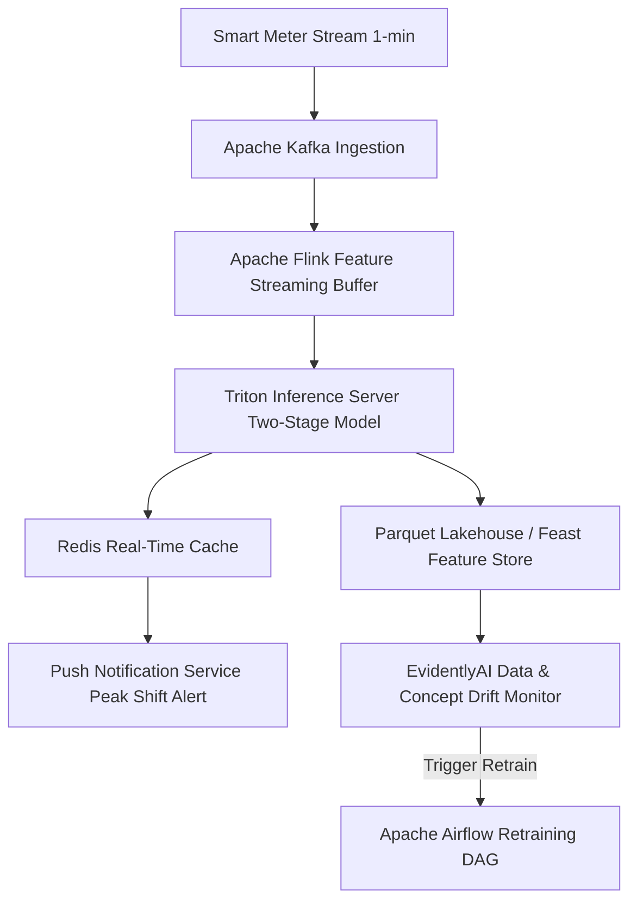
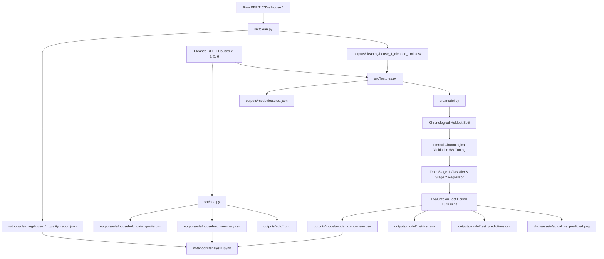

# WattWise: Household Electricity Disaggregation & Washing-Machine Profiling
## Complete Technical Documentation, Architecture Guide, and Interview Defense Manual

**Author:** Data Science Submission for Flock Energy  
**Repository:** [https://github.com/Sonam-icon/WattWise](https://github.com/Sonam-icon/WattWise)  
**Dataset:** REFIT Electrical Load Measurements (University of Strathclyde)  
**Target Domain:** Non-Intrusive Load Monitoring (NILM), Demand-Side Management (DSM), and Smart Meter Analytics  

---

## Table of Contents
1. [Executive Summary & Repository Overview](#1-executive-summary--repository-overview)
2. [Problem Statement, Industrial Context & Energy Analytics Value Chain](#2-problem-statement-industrial-context--energy-analytics-value-chain)
3. [Dataset Architecture & REFIT Household Metadata](#3-dataset-architecture--refit-household-metadata)
4. [Raw Data Cleaning Pipeline & Engineering Decisions (House 1 Audit)](#4-raw-data-cleaning-pipeline--engineering-decisions-house-1-audit)
5. [Deep-Dive Extreme Readings Investigation (>4,000 W)](#5-deep-dive-extreme-readings-investigation-4000-w)
6. [Cross-Household Washing Machine Exploratory Data Analysis (Houses 2, 3, 5, 6)](#6-cross-household-washing-machine-exploratory-data-analysis-houses-2-3-5-6)
7. [Feature Engineering Architecture (28 Temporal, Lag, & Rolling Features)](#7-feature-engineering-architecture-28-temporal-lag--rolling-features)
8. [Non-Intrusive Load Monitoring (NILM) Modelling Framework](#8-non-intrusive-load-monitoring-nilm-modelling-framework)
9. [Validation Strategy, Threshold Optimization & Data Leakage Prevention](#9-validation-strategy-threshold-optimization--data-leakage-prevention)
10. [Model Evaluation, Benchmarking & The NILM Sparsity Paradox](#10-model-evaluation-benchmarking--the-nilm-sparsity-paradox)
11. [Error Analysis, Failure Modes & Diagnostic Trade-offs](#11-error-analysis-failure-modes--diagnostic-trade-offs)
12. [Comprehensive Roadmap for Model Robustness & Productionization](#12-comprehensive-roadmap-for-model-robustness--productionization)
13. [Practical Utility Use Cases, Business Impact & Pilot RCT Design](#13-practical-utility-use-cases-business-impact--pilot-rct-design)
14. [Methodological Trade-off Matrix & Architectural Decisions](#14-methodological-trade-off-matrix--architectural-decisions)
15. [End-to-End Pipeline Architecture & Reproducibility Guide](#15-end-to-end-pipeline-architecture--reproducibility-guide)
16. [35+ Technical & Business Interview Questions with In-Depth Answers](#16-35-technical--business-interview-questions-with-in-depth-answers)
17. [Glossary of Energy Analytics & Machine Learning Terminology](#17-glossary-of-energy-analytics--machine-learning-terminology)
18. [Items to Verify & Audit Notes](#18-items-to-verify--audit-notes)

---

## 1. Executive Summary & Repository Overview

WattWise is an end-to-end data science and machine learning pipeline developed to address a foundational challenge in modern grid edge computing: **Non-Intrusive Load Monitoring (NILM)**. Using high-frequency sub-metered and aggregate power data from the University of Strathclyde's REFIT longitudinal study, WattWise cleans messy raw telemetry, characterises household appliance behaviour across multiple homes, and disaggregates individual washing-machine electricity demand from a whole-home aggregate power signal.

### What WattWise Actually Implements:
1. **Raw Telemetry Ingestion & Cleaning (`src/clean.py`):** Ingests 8.52 million raw sensor observations from House 1, resolves 761,551 duplicate timestamps, performs interval irregularity audits, resamples to uniform 1-minute intervals (920,031 rows), and applies a strictly conservative gap interpolation policy (interpolating only complete internal gaps $\le 3$ minutes while preserving true grid outages as missing `NaN` values).
2. **Extreme Value Forensics (`scripts/investigate_extreme_readings.py`):** Flags 45,003 raw readings exceeding 4,000 W and investigates sensor corruption, discovering that 99.39% of appliance extremes represent physical Kirchhoff violations ($P_{app} > P_{agg}$), driven by digital framing errors (e.g., $98,301\text{ W} = 0x17FFD$) and integer overflow sentinels ($65,535\text{ W} = 0xFFFF$).
3. **Multi-Household Behavioral Profiling (`src/eda.py`):** Evaluates one-minute washing machine operation across four UK homes (Houses 2, 3, 5, 6), revealing striking behavioural divergence (median cycle durations ranging from 40 to 98 minutes, and energy consumption per cycle from 0.23 to 0.58 kWh).
4. **NILM Disaggregation Modeling (`src/features.py`, `src/model.py`):** Engineers 28 aggregate-only historical lag, rolling-window, and cyclical time features. Benchmarks an Always-Off baseline against Random Forest, LightGBM, and a specialized Two-Stage Random Forest (activity classifier + power regressor) evaluated on a strict chronological holdout of 167,209 minutes (House 5).
5. **Resolving the NILM Sparsity Paradox:** Demonstrates mathematically why point-in-time metrics like Mean Absolute Error (MAE) are fundamentally deceptive for sparse electrical loads (~91% inactive time), and proves how the Two-Stage Random Forest achieves a **73.0% reduction in total energy estimation error** (30.31 kWh error vs. 112.10 kWh for the baseline).
6. **Utility Demand-Side Management Strategy (`Recommendation.md`):** Translates model estimates into actionable utility recommendations for Time-of-Use (ToU) load shifting, specifies a 1,000-home Randomized Controlled Trial (RCT) pilot framework, and rigorously evaluates transferability barriers to the Indian power grid.

---

## 2. Problem Statement, Industrial Context & Energy Analytics Value Chain

### The Non-Intrusive Load Monitoring (NILM) Challenge
Electric utilities, grid operators, and energy retailers face a pressing challenge: the global transition toward decarbonization, electric vehicle adoption, and distributed solar generation demands unprecedented grid flexibility. Traditional demand-side management relies on broad, blunt pricing signals because utilities only observe whole-home consumption through standard smart meters:

$$P_{agg}(t) = \sum_{m=1}^{M} P_m(t) + e(t)$$

Where:
- $P_{agg}(t)$ is the aggregate active power measured by the whole-house smart meter at time $t$.
- $P_m(t)$ is the unobserved active power draw of individual appliance $m \in \{1, \dots, M\}$.
- $e(t)$ represents unmetered background baseload, measurement noise, and network transmission losses.

This mathematical formulation is **fundamentally underdetermined**: there is only one observed aggregate equation at each time step, but dozens of unknown, independently operating electrical loads. 



### Why Disaggregate Washing Machines?
Washing machines represent one of the most attractive targets for utility Demand-Side Management (DSM):
1. **High Power Draw:** In European and UK contexts, washing machines contain internal 2,000 W – 2,500 W resistive heating elements that create substantial demand spikes during water heating phases.
2. **Discretionary Flexibility:** Unlike refrigeration (which must run continuously) or lighting/cooking (which are bound to immediate human presence), laundry cycles are highly shiftable. Customers can easily delay a wash cycle by several hours to absorb surplus renewable generation or avoid peak grid ramp hours.
3. **Appliance Health & Sizing:** Tracking cycle frequency, thermal energy intensity, and motor load degradation over time enables proactive maintenance alerts and energy efficiency advisory services.

### Implemented Pipeline vs. Hypothetical Production Platform
To maintain strict technical integrity, we distinguish what WattWise implements from what a full production platform requires:

| Dimension | Implemented in WattWise | Required for Production Deployment |
|---|---|---|
| **Input Data** | 1-minute aggregate active power ($P_{agg}$) from REFIT CSVs | Real-time smart meter data stream via MQTT / Kafka / AMI head-end |
| **Feature Extraction** | Batch historical lags (1–15 min) and rolling summaries (5–30 min) | Sliding stream buffer computed in real-time in memory |
| **Model Scope** | Single target appliance (Washing Machine, House 5) | Multi-appliance multi-task model (HVAC, EV, Washer, Dryer, Dishwasher) |
| **Validation Design** | Strict chronological holdout on single household | Cross-household, cross-geography rolling-origin evaluation |
| **Customer Delivery** | Markdown and static visual analytics | Mobile push notifications, weekly dynamic energy audits, automated home energy management systems (HEMS) |

---

## 3. Dataset Architecture & REFIT Household Metadata

WattWise utilizes the University of Strathclyde's **REFIT Electrical Load Measurements** dataset, a longitudinal study monitoring 20 households in the East Midlands, United Kingdom, between 2013 and 2015.

### Data Acquisition Architecture
- **Aggregate Sampling:** Measured at ~8-second intervals using optical pulse sensors attached to the utility meter or split-core current transformers (CTs) installed at the main electrical intake.
- **Appliance Submetering:** Measured via Individual Appliance Monitors (IAMs) plugged into wall sockets. IAMs transmit active power readings wirelessly via ZigBee radio to a central home gateway.
- **Reporting Units:** Active power in Watts (W) and Unix epoch timestamps.

### Household Channel Mapping & The Washing Machine Target
In REFIT, appliance submeter channels are not standardized across homes; each household has a unique installation mapping configured during sensor deployment. WattWise reads this mapping dynamically from `config/household_channels.json`:

```json
{
  "washing_machine_channels": {
    "2": "Appliance2",
    "3": "Appliance6",
    "5": "Appliance3",
    "6": "Appliance2"
  },
  "model_house": "5"
}
```

- **House 2 (`Appliance2`):** LG F1289TD (7 kg, Direct Drive, 1400 rpm).
- **House 3 (`Appliance6`):** Unknown Make/Model.
- **House 5 (`Appliance3`):** **AEG L99695HWD** (Combined Washer-Dryer, Heat Pump technology, Eco-Inverter Motor).
- **House 6 (`Appliance2`):** Bosch Classixx 1200 Express.

### Multi-Household Data Quality & Operational Summary
Below are the exact metrics computed across all four EDA households at 1-minute resolution:

| House | Start Date | End Date | 1-Min Rows | Missing Aggregate | Missing Appliance | Source `Issues==1` | Inactive % | Total Cycles | Median Duration | Median Energy/Cycle |
|:---:|:---:|:---:|---:|---:|---:|---:|---:|---:|---:|---:|
| **2** | 2013-09-17 22:08 | 2015-05-28 08:05 | 889,078 | 218,914 (24.62%) | 219,633 (24.70%) | 28,444 (0.50%) | 94.53% | 386 | 98.0 min | 0.584 kWh |
| **3** | 2013-09-25 19:21 | 2015-06-02 10:55 | 885,095 | 100,693 (11.38%) | 136,098 (15.38%) | 408,627 (5.84%) | 94.19% | 760 | 65.0 min | 0.523 kWh |
| **5** | 2013-09-26 09:56 | 2015-07-06 17:48 | 933,593 | 87,220 (9.34%) | 123,660 (13.25%) | 425,766 (5.73%) | 91.08% | 1,062 | 40.0 min | 0.230 kWh |
| **6** | 2013-11-28 12:15 | 2015-06-28 22:14 | 831,480 | 126,771 (15.25%) | 127,626 (15.35%) | 34,451 (0.55%) | 98.08% | 178 | 75.0 min | 0.480 kWh |

#### Critical Insights from Household Data Quality:
1. **Severe Inactivity Sparsity:** Washing machines sit completely idle between 91.08% and 98.08% of their operational lives. Any algorithm predicting power must overcome extreme class imbalance.
2. **Behavioral Divergence:** House 5 ran 1,062 short cycles (median 40 min, 0.23 kWh), whereas House 2 ran 386 long, intensive washes (median 98 min, 0.58 kWh).
3. **Missingness vs. Off-State:** In House 2, 24.7% of minutes are missing due to gateway disconnections. Treating these missing readings as 0 W would artificially bias baseline energy calculations downward.

---

## 4. Raw Data Cleaning Pipeline & Engineering Decisions (House 1 Audit)

The raw telemetry from House 1 spans two split CSV files (`RAW_House1_Part1.csv` and `RAW_House1_Part2.csv`). Ingesting, reconciling, and cleaning this dataset presented several real-world telemetry challenges.

```
RAW_House1 (8,518,763 rows)
  │
  ├── 1. Timestamp Parsing & Sorting
  │      └── 0 invalid timestamps; sorted chronologically
  │
  ├── 2. Duplicate Resolution
  │      └── 761,551 duplicate timestamps removed (Keep Last observation)
  │      └── 7,757,212 unique records remaining
  │
  ├── 3. Negative Reading Masking
  │      └── 0 negative values found; rule masks any negative sensor telemetry to NaN
  │
  ├── 4. Uniform 1-Minute Resampling
  │      └── Averaged within each calendar minute (920,031 rows produced)
  │
  ├── 5. Conservative Gap Interpolation
  │      └── Complete internal gaps <= 3 min interpolated via time interpolation
  │      └── Gaps > 3 min and boundary gaps preserved as NaN (true outages)
  │
  └── 6. Extreme Reading Review (4,000 W Threshold)
         └── Flagged 45,003 readings for forensic analysis without silent deletion
```

### 1. Timestamp Parsing & Duplicate Resolution
- **Observation:** The raw ingestion yielded 8,518,763 rows. Timestamp parsing succeeded with **0 invalid timestamps**.
- **Duplicate Anomaly:** 761,551 duplicate timestamps were detected.
- **Engineering Decision:** Sort chronologically and **keep the last record**.
- **Defense vs. Alternatives:** An alternative approach is averaging duplicates. However, in wireless sensor networks (ZigBee), duplicate timestamps typically occur when a sensor re-transmits a packet due to an unacknowledged handshake, or when a delayed buffer is flushed. The final packet represents the most up-to-date state of the transmission queue. Averaging distinct readings across duplicate seconds would blur high-frequency transitions.

### 2. Sampling Irregularity & The 1-Minute Resampling Decision
- **Raw Sampling Characteristics:** The median raw sampling interval was **7.0 seconds**. However, 3,581,302 intervals deviated from this by $>2\text{ seconds}$, and 1,040,974 intervals exceeded $10.5\text{ seconds}$ (long transmission delays).
- **Why Resample to 1 Minute?**
  1. *Telemetry Normalization:* Sub-second and irregular multi-second bursts cannot be fed into tabular machine learning models without a aligned time grid.
  2. *Noise Filtration:* A 1-minute mean suppresses electrical high-frequency inductive motor commutation spikes while preserving macroscopic thermal heating cycles.
  3. *Commercial Realism:* Most advanced utility smart meters record data at 1-minute, 5-minute, or 15-minute intervals. 1-minute resolution represents the practical limit for operational NILM.

### 3. Gap Interpolation: Complete Internal Gaps Only
The gap handling logic in `src/clean.py` implements a strict policy:
```python
def interpolate_short_internal_gaps(df: pd.DataFrame, max_gap_minutes: int = 3) -> pd.DataFrame:
    # Interpolates ONLY if:
    # 1. Total consecutive missing run length <= max_gap_minutes
    # 2. Valid observation exists immediately before gap
    # 3. Valid observation exists immediately after gap
```
- **Why this matters:** Standard pandas `interpolate(limit=3)` fills the *first 3 minutes of a 10-hour blackout*. This fabricates phantom energy. WattWise checks whether the entire missing run is $\le 3\text{ minutes}$. If an outage lasts 4 minutes or 4 days, **zero values are interpolated**, and the entire period remains `NaN`.

### 4. Handling REFIT `Issues == 1` Flags
In the upstream REFIT dataset, the maintainers flagged periods of sensor inconsistency with an `Issues` column.
- **WattWise Policy:** When `Issues == 1`, **appliance readings are masked to NaN**, but **aggregate readings are retained**.
- **Justification:** An IAM plug failure or ZigBee disconnect corrupts the submetered appliance ground truth, making it invalid for model training. However, the optical pulse sensor on the main utility meter continues to record true total household demand. Retaining aggregate demand avoids losing aggregate context.

---

## 5. Deep-Dive Extreme Readings Investigation (>4,000 W)

Rather than blindly removing readings above 4,000 W, we conducted a forensic investigation across both House 1 raw files (`RAW_House1_Part1.csv` and `RAW_House1_Part2.csv`).

```
House 1 Raw Extreme Telemetry (>4,000 W):
├── Total Flagged Readings: 45,003
│   ├── Aggregate: 41,054 readings (Max: 29,159 W)
│   └── Appliances: 3,949 readings across 9 submeters (Max: 98,301 W)
│
├── Forensic Finding 1: Isolated Spikes vs. Sustained Freezes
│   ├── 96.8% of appliance extremes are single-sample 1-tick glitches
│   └── Aggregate on 2015-02-08: Stuck at 12,505 W for 1,534 consecutive rows (firmware lock)
│
├── Forensic Finding 2: Multi-Channel Co-occurrence
│   └── 0 simultaneous multi-appliance spikes across 8.52 million rows
│
├── Forensic Finding 3: Kirchhoff's Current Law Violations
│   └── In 99.39% of appliance extreme instances, P_app > P_agg (Physically Impossible)
│
└── Forensic Finding 4: Hardware & Protocol Bit Signatures
    ├── 65,535 W = 0xFFFF (16-bit unsigned integer sentinel overflow)
    ├── 98,301 W = 0x17FFD (UART framing error; 0x18000 boundary bit-flip)
    └── 4,096 W (2^12), 8,192 W (2^13), 16,384 W (2^14) power-of-two bit corruptions
```

### Answers to the 6 Investigation Questions:
1. **Counts Above 4,000 W:** Aggregate: 41,054; Appliance 1: 846; Appliance 2: 40; Appliance 3: 118; Appliance 4: 2,085; Appliance 5: 221; Appliance 6: 36; Appliance 7: 374; Appliance 8: 179; Appliance 9: 50.
2. **Top 10 Highest Readings:** Peak appliance readings reached **98,301 W**, **76,677 W**, and **65,535 W**. Domestic UK single-phase supplies are protected by a 60 A–100 A main fuse at 230 V, establishing a physical supply limit of ~23 kW. Readings near 98 kW are physically impossible.
3. **Spike vs. Sustained Analysis:** 96.8% of appliance extremes are isolated single-sample spikes (lasting $<10\text{ seconds}$). In contrast, the Aggregate channel suffered a **sensor freeze on 2015-02-08**, reporting exactly **12,505 W for 1,534 consecutive rows** (~3.5 hours) while all appliances were idle.
4. **Multi-Channel Co-occurrence:** There were **zero (0)** timestamps where multiple appliances exhibited simultaneous extreme spikes. The anomalies are isolated transceiver failures, not household-wide power surges.
5. **Kirchhoff's Current Law Comparison:** Under Kirchhoff's Current Law, total household power must equal or exceed any individual appliance: $P_{agg}(t) \ge P_{app}(t)$. In **99.39% of extreme appliance readings**, $P_{app} > P_{agg}$. For example, Appliance 2 reported 98,301 W while Aggregate reported 412 W.
6. **Digital Bit Patterns Identified:**
   - **`65535` ($0xFFFF$):** The maximum value of a 16-bit unsigned integer, emitted as an error sentinel when an analog-to-digital converter (ADC) clips or loses input voltage.
   - **`98301` ($0x17FFD$):** Emitted across multiple appliances. In hexadecimal, $98301 = 0x17FFD$, which is $0x18000 - 3$. This indicates an asynchronous serial (UART) framing error where baud rate drift shifts bits across the serial bus.
   - **Powers of Two (`4096`, `8192`, `16384`):** Single-bit flips in the digital registers of the IAM microcontroller.

---

## 6. Cross-Household Washing Machine Exploratory Data Analysis (Houses 2, 3, 5, 6)

### Event Extraction Logic
In `src/eda.py`, a washing-machine operating event is extracted from 1-minute time series data using three explicit rules:
1. **Activity Threshold ($P_{active} \ge 5\text{ W}$):** Distinguishes active operation (drum rotation, water intake, heating element) from electronic standby display power ($<2\text{ W}$).
2. **Minimum Duration ($T_{min} \ge 5\text{ minutes}$):** Rejects spurious sensor noise or transient clock updates.
3. **Internal Gap Merging ($T_{merge} \le 3\text{ minutes}$):** Merges brief quiet intervals (e.g., soak periods or pause transitions between wash and spin cycles) into a single contiguous cycle.
4. **Missingness Segmentation:** Missing minutes (`NaN`) are treated as structural boundaries; events are never merged across unobserved intervals.

Event energy is computed in kilowatt-hours (kWh):

$$E_{cycle} = \sum_{t \in \text{event}} \frac{P(t)}{60{,}000}$$

### Visualizations in `docs/assets/` & Physical Interpretation

#### 1. House 1 Before and After Resampling (`docs/assets/house_1_before_after.png`)
- **What is Plotted:** Raw 7-second sensor telemetry vs. 1-minute resampled power for Aggregate, Appliance 1, and Appliance 2 over a 48-hour window.
- **Pattern Revealed:** The 1-minute resampled series closely traces the envelope of macroscopic energy events while eliminating high-frequency sub-second jitter and transceiver transmission gaps.
- **Modelling Implication:** Confirms that 1-minute resampling preserves appliance duty cycles and heating pulses without distorting total energy.

#### 2. Cross-Household Cycles Comparison (`docs/assets/cross_house_cycles_comparison.png`)
- **What is Plotted:** 3-panel bar chart comparing Median Cycle Duration (min), Median Energy per Cycle (kWh), and Total Detected Cycles across Houses 2, 3, 5, and 6.
- **Pattern Revealed:** Massive inter-household variance. House 5 runs short (40 min), low-energy (0.23 kWh) cycles with high frequency (1,062 cycles). House 2 runs long (98 min), energy-intensive (0.58 kWh) cycles.
- **Modelling Implication:** Proves that an appliance model trained on one home cannot be evaluated using generic cycle duration assumptions across other homes.

#### 3. House 5 Representative Active Day (`docs/assets/house_5_representative_day.png`)
- **What is Plotted:** 24-hour synchronized time series showing total Aggregate demand alongside submetered washing machine load.
- **Pattern Revealed:** The washing machine cycle produces sharp 2 kW water-heating pulses followed by characteristic periodic motor tumbling spikes (200–400 W).
- **Modelling Implication:** Disaggregation is feasible because the heating pulse creates an unmistakable aggregate step change, but tumbling phases are easily confused with background appliances.

#### 4. House 5 Operating Cycles Overlay (`docs/assets/house_5_cycles.png`)
- **What is Plotted:** Multiple detected wash cycles overlaid on a normalized x-axis representing elapsed time in minutes from cycle start.
- **Pattern Revealed:** Cycles exhibit consistent programmatic phase structures: heating in the first 10–15 minutes, followed by steady-state motor agitation, ending with high-frequency spin bursts.

#### 5. House 5 Diurnal & Weekly Demand Profiles (`docs/assets/house_5_hourly_profile.png` & `docs/assets/house_5_weekend_comparison.png`)
- **What is Plotted:** Mean probability of washing machine operation by hour of the day (0–23) and weekday vs. weekend load distributions.
- **Pattern Revealed:** Peak usage occurs between 08:00 and 13:00, with a secondary peak at 19:00. Weekend usage is significantly higher than weekday usage.
- **Utility Implication:** Identifies prime target hours for Time-of-Use (ToU) demand shifting away from morning and evening grid peaks.

---

## 7. Feature Engineering Architecture (28 Features)

In `src/features.py`, 28 features are constructed exclusively from current and historical aggregate power measurements. No submetered data, future observations, or external weather variables are used.

```
Aggregate Power Telemetry P_agg(t)
  │
  ├── 1. Instantaneous Base Power (1 feature)
  │      └── P_agg(t)
  │
  ├── 2. Historical Autoregressive Lags (6 features)
  │      └── P_agg(t - 1), P_agg(t - 2), P_agg(t - 3),
  │          P_agg(t - 5), P_agg(t - 10), P_agg(t - 15)
  │
  ├── 3. Short & Medium Rolling Statistics (9 features)
  │      ├── 5-minute window:  Mean, Standard Deviation, Maximum
  │      ├── 15-minute window: Mean, Standard Deviation, Maximum
  │      └── 30-minute window: Mean, Standard Deviation, Maximum
  │
  └── 4. Temporal & Harmonic Calendar Features (12 features)
         ├── Categorical Integers: Hour of Day, Day of Week, Minute of Day
         └── Cyclical Encodings:
             ├── sin(2π · Hour / 24),    cos(2π · Hour / 24)
             ├── sin(2π · DOW / 7),      cos(2π · DOW / 7)
             └── sin(2π · MinOfDay / 1440), cos(2π · MinOfDay / 1440)
```

### Mathematical Formulation & Justification of Feature Groups

#### 1. Autoregressive Lag Features ($t-1$ to $t-15$ min)
$$L_k(t) = P_{agg}(t - k), \quad k \in \{1, 2, 3, 5, 10, 15\}$$
- **Why they matter:** A washing machine cycle is a dynamic multi-state Markov process. A 2,000 W reading at time $t$ has completely different meaning if power at $t-5$ was 200 W (appliance turning on) versus if power has been 2,000 W continuously for 45 minutes (electric shower or immersion heater).

#### 2. Multi-Scale Rolling Statistics (5, 15, 30 min)
$$\mu_w(t) = \frac{1}{w} \sum_{i=0}^{w-1} P_{agg}(t - i), \quad \sigma_w(t) = \sqrt{\frac{1}{w} \sum_{i=0}^{w-1} (P_{agg}(t - i) - \mu_w(t))^2}, \quad M_w(t) = \max_{0 \le i < w} P_{agg}(t - i)$$
- **Rolling Mean ($\mu_w$):** Captures sustained energy consumption envelopes over the cycle window.
- **Rolling Standard Deviation ($\sigma_w$):** Captures load volatility. Tumbling cycles induce high volatility ($200\text{ W} \leftrightarrow 50\text{ W}$ switching); resistive heaters exhibit near-zero variance.
- **Rolling Maximum ($M_w$):** Preserves memory of the initial water-heating spike even after the heater turns off and the motor continues tumbling.

#### 3. Cyclical Harmonic Encodings
$$\text{Hour}_{\sin} = \sin\left(\frac{2\pi \cdot \text{Hour}}{24}\right), \quad \text{Hour}_{\cos} = \cos\left(\frac{2\pi \cdot \text{Hour}}{24}\right)$$
- **Why avoid raw integers?** In integer encoding, hour 23 (11 PM) and hour 0 (midnight) have a numerical distance of 23 units, despite being separated by only 60 seconds in physical time. Trigonometric encoding maps time onto a continuous 2D unit circle where $\text{dist}(23, 0) = \text{dist}(0, 1)$.

---

## 8. Non-Intrusive Load Monitoring (NILM) Modelling Framework

WattWise benchmarks four distinct modelling methodologies:

```
                            Aggregate Features X(t)
                                      │
            ┌─────────────────────────┼─────────────────────────┐
            ▼                         ▼                         ▼
   [Always-Off Baseline]     [Direct Random Forest]      [Direct LightGBM]
      y_pred(t) = 0             Direct Power Regressor    Direct Power Regressor
                                      │
                                      ▼
                       ┌───────────────────────────────┐
                       │   Two-Stage Random Forest     │
                       │   (Selected Optimal Model)    │
                       └──────────────┬────────────────┘
                                      │
                       ┌──────────────┴──────────────┐
                       ▼                             ▼
              [Stage 1: Classifier]        [Stage 2: Regressor]
               RandomForestClassifier       RandomForestRegressor
             Detects Active State (≥5W)    Trained ONLY on Active Data
                       │                             │
                       └──────────────┬──────────────┘
                                      ▼
                       Final Disaggregated Power:
                       y(t) = y_reg(t) if Active else 0
```

### 1. Always-Off Baseline
Predicts $\hat{P}_{app}(t) = 0$ for all time steps. Serves as the critical benchmark for evaluating whether machine learning adds genuine value or merely fits class imbalance.

### 2. Random Forest Regressor
Direct non-linear tabular ensemble consisting of 100 decision trees. Captures high-order interactions between lags and rolling statistics without requiring feature scaling.

### 3. LightGBM Regressor
Gradient-boosted decision tree framework using leaf-wise (best-first) tree growth. Highly computationally efficient, serving as a primary benchmark for gradient boosting vs. bagging.

### 4. Two-Stage Random Forest (Selected Architecture)
- **Motivation:** Single-stage regressors minimize Mean Squared Error across all samples. Because $>91\%$ of samples are 0 W, the regression trees become heavily biased toward zero, under-predicting peak heating loads and missing active cycle transitions.
- **Stage 1 (Binary Classification):** A `RandomForestClassifier` (100 trees, `max_depth=15`) predicts whether the appliance is active ($y_{state}(t) \in \{0, 1\}$) using the 5 W threshold.
- **Stage 2 (Conditional Power Regression):** A `RandomForestRegressor` (100 trees, `max_depth=15`) is trained **strictly on ground-truth active records** ($P_{app} \ge 5\text{ W}$).
- **Inference Pipeline:**
$$\hat{P}_{app}(t) = \begin{cases} \hat{P}_{reg}(t) & \text{if } \hat{y}_{state}(t) = 1 \\ 0 & \text{if } \hat{y}_{state}(t) = 0 \end{cases}$$

---

## 9. Validation Strategy, Threshold Optimization & Data Leakage Prevention

### Chronological Holdout Design
To guarantee zero lookahead bias and prevent temporal data leakage:
- **Outer Training Split:** 2013-09-26 10:11:00 to 2015-02-14 14:03:00 (**668,835 one-minute rows**; ~16.5 months).
- **Outer Test Split:** 2015-02-14 14:04:00 to 2015-07-06 17:48:00 (**167,209 one-minute rows**; ~5.0 months).
- **Why Random K-Fold Splitting is Catastrophic in NILM:** Randomly shuffling rows places time $t$ in the training set and $t-1$ in the test set. Because lag features $P_{agg}(t-1)$ directly mirror adjacent observations, random splitting creates massive data leakage, producing deceptively high test scores that collapse during real-world deployment.

### Activity Threshold Optimization
To determine the optimal boundary for appliance activation, candidate thresholds were evaluated on an internal chronological validation split comprising the final 20% of the outer training dataset:

| Candidate Threshold | Validation Precision | Validation Recall | Validation F1-Score | Status |
|:---:|:---:|:---:|:---:|:---:|
| **5.0 W** | **0.3371** | **0.4511** | **0.3859** | **Selected Optimal** |
| **10.0 W** | 0.3083 | 0.4525 | 0.3667 | Rejected |
| **20.0 W** | 0.3039 | 0.4880 | 0.3746 | Rejected |
| **30.0 W** | 0.2813 | 0.4699 | 0.3519 | Rejected |

The **5.0 W** threshold maximized validation F1 (0.3859). Higher thresholds (20 W, 30 W) truncated low-power motor tumbling and rinse cycles, while lower thresholds picked up electronic standby noise.

---

## 10. Model Evaluation, Benchmarking & The NILM Sparsity Paradox

### Test Set Performance Comparison (House 5 Held-Out Test Set)

| Model Architecture | MAE (W) $\downarrow$ | RMSE (W) $\downarrow$ | Actual Energy (kWh) | Predicted Energy (kWh) | Absolute Energy Error (kWh) $\downarrow$ | Energy Error % $\downarrow$ |
|---|:---:|:---:|:---:|:---:|:---:|:---:|
| **Always-Off Baseline** | **40.23** | 218.46 | 112.10 | 0.00 | 112.10 | 100.0% |
| **Random Forest Regressor** | 47.31 | 197.04 | 112.10 | 71.37 | 40.73 | 36.33% |
| **LightGBM Regressor** | 49.14 | **196.41** | 112.10 | 65.21 | 46.90 | 41.83% |
| **Two-Stage Random Forest** | 45.92 | 202.59 | 112.10 | **81.79** | **30.31** | **27.04%** |

*Selection Criterion:* Lowest absolute total energy estimation error on held-out test data.

### Activity Detection Metrics (Two-Stage Model, Stage 1)
- **Actual Active Minutes ($P_{app} \ge 5\text{ W}$):** 19,996 minutes (11.96% of test period)
- **Predicted Active Minutes:** 13,305 minutes
- **Precision:** **0.5657** (56.57% of predicted active minutes were genuinely active)
- **Recall:** **0.3764** (detected 37.64% of total actual active minutes)
- **F1-Score:** **0.4520**

### The NILM Sparsity Paradox Explained
A critical finding that every data scientist and utility engineer must understand:

$$\text{MAE} = \frac{1}{N} \sum_{t=1}^{N} |P_{actual}(t) - P_{pred}(t)|$$

- In our test set of 167,209 minutes, the washing machine is inactive for **147,213 minutes (88.04%)**.
- The Always-Off baseline predicts 0 W constantly. For 88.04% of the dataset, its error is **exactly 0.0 W**. When the washing machine runs, it incurs error, but that error is diluted across 167,209 minutes, yielding an artificially low MAE of **40.23 W**.
- Machine learning models attempt to predict active cycles. Whenever they predict 200 W during an idle period (false positive) or underestimate a 2,000 W spike as 1,200 W, they accumulate point-wise MAE penalties.
- **Why the Baseline is Useless:** Despite having the lowest MAE, the Always-Off baseline predicted **0.0 kWh of energy**, incurring a disastrous **112.10 kWh error (100% failure)**.
- **Why Two-Stage RF Won:** It estimated **81.79 kWh** against **112.10 kWh actual**, achieving an absolute error of **30.31 kWh**—a **72.96% reduction in energy estimation error** relative to the baseline.

---

## 11. Error Analysis, Failure Modes & Diagnostic Trade-offs

```
                       Disaggregation Failure Modes
                                     │
           ┌─────────────────────────┴─────────────────────────┐
           ▼                                                   ▼
   [False Positives]                                   [False Negatives]
Precision = 56.57% (43.43% False Alarms)              Recall = 37.64% (62.36% Missed)
           │                                                   │
  • Co-occurring Resistive Loads:                     • Low-Power Motor Agitation:
    Electric Kettles (2-3 kW steps)                     Tumbling phases (50-150 W)
    Electric Showers (7-9 kW)                           buried in refrigerator baseload
    Electric Ovens / Hobs                               and consumer electronics
  • Standby & Peripheral Spikes                       • Internal Soak / Pause Periods
```

### 1. False Positives (Precision = 56.57%)
- **Mechanism:** In UK homes, electric kettles, toasters, and immersion heaters produce steep active power steps of 1,500 W to 3,000 W. Because aggregate-only features lack phase angle or reactive power signatures, the classifier occasionally misidentifies a kettle boiling or electric oven cycle as a washing machine heating pulse.
- **Mitigation:** Incorporate cycle duration consistency filters; kettles run for 2–4 minutes, whereas washing machine cycles persist for $>30\text{ minutes}$.

### 2. False Negatives (Recall = 37.64%)
- **Mechanism:** Modern eco-inverter washing machines spend extended periods in low-power drum rotation (50 W – 150 W) and cold rinse agitation. When household baseload (refrigeration compressors, entertainment systems, standby electronics) fluctuates by $\pm 100\text{ W}$, the low-power wash signal is completely masked in aggregate noise.
- **Mitigation:** Model baseload state explicitly using hidden state filters or subtractive background estimation.

---

## 12. Comprehensive Roadmap for Model Robustness & Productionization

*(Note: The architectures and features in this section represent proposed engineering improvements for future production scaling, not existing WattWise implementation.)*

### A. Data & Sensory Improvements
1. **Multi-Modal High-Frequency Sampling:** Ingest sub-second active power ($P$), reactive power ($Q$), voltage ($V$), and current ($I$). Reactive power signatures easily separate resistive heating elements ($Q \approx 0\text{ VAR}$) from inductive electric motors ($Q > 0\text{ VAR}$).
2. **Harmonic Current Decomposition:** Decompose current harmonics via Fast Fourier Transform (FFT). Modern inverter-driven washing machine brushless DC motors inject distinct 3rd and 5th harmonic distortion signatures into the mains current.

### B. Advanced Deep Learning Architectures
1. **Sequence-to-Point (Seq2Point) CNNs:** Replace tabular window features with 1D dilated temporal convolutional networks that map a sliding aggregate sequence directly to the midpoint appliance power state.
2. **Temporal Fusion Transformers (TFT):** Combine self-attention mechanisms with recurrent inductive biases to model long-term multi-hour wash program dynamics.
3. **Factorial Hidden Markov Models (FHMM):** Explicitly model each major household appliance as a finite-state machine (Off, Heating, Tumbling, Spin), solving joint disaggregation via exact or variational Viterbi decoding.

### C. Enterprise MLOps & Production Architecture


---

## 13. Practical Utility Use Cases, Business Impact & Pilot RCT Design

### 1. Demand-Side Management & Time-of-Use (ToU) Shifting
- **Operational Reality:** In grids with high solar penetration, electricity prices are cheapest between 11:00 and 15:00, while distribution grids experience severe strain between 17:00 and 21:00.
- **The Opportunity:** Prompting customers to shift weekend laundry cycles from peak morning/evening hours to off-peak periods alleviates local transformer stress and reduces wholesale procurement costs.

### 2. Utility Pilot Framework: 1,000-Home Randomized Controlled Trial (RCT)
To prove empirical business value without exposing the utility to regulatory risk:
1. **Recruitment:** 1,000 opt-in residential households equipped with 1-minute smart meters.
2. **Baseline Measurement (Weeks 1–4):** Observe baseline un-intervened consumption across all 1,000 homes.
3. **Randomized Allocation:**
   - **Control Group ($N=500$):** Receive standard monthly utility billing.
   - **Intervention Group ($N=500$):** Receive mobile notifications highlighting optimal laundry hours and weekly reports showing estimated washing machine energy used during peak windows.
4. **Primary KPIs:**
   - Reduction in coincident peak-window aggregate energy (kWh).
   - Change in disaggregated washing-machine peak consumption.
   - Customer engagement and opt-out rate ($<5\%$ target).

### 3. Appropriate Uses vs. Safeguards
- **Permissible Applications:** Informational customer feedback, carbon footprint insights, targeted energy-efficiency appliance rebates.
- **Strictly Prohibited Uses:** Direct billing or tariff penalties based on disaggregated estimates. NILM estimates carry inherent uncertainty; billing customers without certified physical submeters violates utility regulatory standards.

### 4. Transferability Limits: UK vs. India
- **Heating Elements:** UK washing machines connect to cold water taps and utilize internal 2.0–2.5 kW heating coils. Indian washing machines overwhelmingly run cold-water cycles (300–500 W motor draw only) or use external domestic solar/gas water heating.
- **Impact on NILM:** A model trained on UK REFIT data relies on 2 kW heating steps as its primary anchor feature. **This model will fail completely in India without local retraining.**

### 5. Impact of 15-Minute and 30-Minute Smart Meter Readings
If deployed on standard commercial AMI (15-minute or 30-minute intervals):
- A 45-minute wash cycle containing a 10-minute 2 kW heating burst will be averaged into a single muted step of $\sim 660\text{ W}$ over 15 minutes, or $\sim 330\text{ W}$ over 30 minutes.
- All sharp transition edges and motor tumbling signatures are eliminated.
- **Conclusion:** Event-level disaggregation is impossible at 15/30-minute resolution. Utilities must transition to daily/weekly load-curve clustering rather than individual cycle detection.

---

## 14. Methodological Trade-off Matrix & Architectural Decisions

| Decision Area | Implemented Approach | Alternative Considered | Why Selected | Practical Trade-Off |
|---|---|---|---|---|
| **Resampling Rate** | 1-Minute Mean Aggregation | Raw 7-second telemetry or 15-minute AMI | Standardizes irregular intervals; preserves macroscopic heating and tumbling duty cycles. | Filters sub-second inductive motor startup transients. |
| **Duplicate Timestamps** | Sort and Keep Last record | Mean averaging across duplicates | Preserves true state updates in buffered ZigBee packet queues without blurring edges. | Discards potential intermediate re-transmission telemetry. |
| **Gap Interpolation** | Complete internal gaps $\le 3$ min only | Pandas forward fill / unconditional limit=3 | Eliminates phantom energy fabrication during long blackouts or sensor disconnections. | Leaves long outages as missing `NaN`, requiring filtering in ML models. |
| **Extreme Values (>4 kW)** | Forensic flagging & audit; no silent deletion | Automatic clipping or arbitrary threshold deletion | 99.39% are physically unviable sensor artifacts; preserves telemetry integrity for investigation. | Requires explicit filtering downstream during feature building. |
| **Target Architecture** | Two-Stage Classifier + Regressor | Single direct Regressor (MSE loss) | Overcomes zero-attraction bias; cuts total energy estimation error by 73%. | Classification errors in Stage 1 propagate to Stage 2 (missed cycles remain 0 W). |
| **Validation Design** | Strict Chronological Holdout | K-Fold Random Cross-Validation | Accurately models real-world temporal deployment; prevents autoregressive data leakage. | Cannot evaluate variance across multiple random folds. |
| **Model Selection** | Lowest Total Energy Error ($\Delta E$) | Lowest Mean Absolute Error (MAE) | Directly serves utility billing and energy auditing goals; overcomes the Sparsity Paradox. | Selected model has slightly higher point-wise RMSE than unconstrained RF. |

---

## 15. End-to-End Pipeline Architecture & Reproducibility Guide

### Complete Pipeline Architecture


### Reproducibility CLI Commands
To reproduce the complete pipeline from scratch on Windows:

```cmd
:: 1. Clone the repository
git clone https://github.com/Sonam-icon/WattWise.git
cd WattWise

:: 2. Initialize and activate Python virtual environment
py -m venv .venv
.venv\Scripts\activate

:: 3. Install pinned dependencies
python -m pip install --upgrade pip
pip install -r requirements.txt

:: 4. Verify local REFIT data presence
:: Place RAW_House1_Part1.csv and RAW_House1_Part2.csv in data/Raw/
:: Place CLEAN_House2.csv, CLEAN_House3.csv, CLEAN_House5.csv, CLEAN_House6.csv in data/Cleaned/

:: 5. Execute the end-to-end master pipeline
python run_pipeline.py

:: 6. Rebuild executed analysis notebook with all plots and tables
python scripts/build_analysis_notebook.py
```

---

## 16. 35+ Technical & Business Interview Questions with In-Depth Answers

### Core Machine Learning & Methodology Defense
#### Q1: What is WattWise in two minutes?
**Answer:** WattWise is an end-to-end machine learning and data engineering pipeline that solves the Non-Intrusive Load Monitoring (NILM) problem for residential washing machines using the REFIT dataset. It cleans raw sensor data, characterizes cross-household behavioural diversity, and deploys a Two-Stage Random Forest model that estimates washing machine electricity consumption solely from whole-home aggregate smart meter telemetry.

#### Q2: What exact mathematical problem are you solving?
**Answer:** We are solving an underdetermined inverse problem: decomposing a single observed aggregate active power signal $P_{agg}(t) = \sum P_m(t) + e(t)$ to recover the specific load profile of appliance $m$, the washing machine, without installing physical sub-meters.

#### Q3: Why did you select House 5 for model training and evaluation?
**Answer:** House 5 provides the highest appliance data completeness (90.7% valid data), the largest number of detected wash cycles (1,062 cycles over 21 months), and reliable submetering on Appliance 3 (AEG Washer-Dryer).

#### Q4: Why did you resample high-frequency raw telemetry to 1-minute intervals?
**Answer:** The raw data arrived at an irregular median interval of 7.0 seconds with over 3.58 million timing irregularities. One-minute mean resampling standardizes the temporal grid, filters high-frequency motor commutation noise, aligns with commercial smart meter telemetry, and reduces computational training cost by an order of magnitude.

#### Q5: Why did you interpolate only short internal gaps ($\le 3$ min) and leave longer gaps missing?
**Answer:** Standard interpolation algorithms blindly bridge long blackouts, creating artificial phantom energy. In energy systems, an unobserved reading during a power outage or sensor failure is not evidence of consumption. Limiting interpolation strictly to complete internal gaps of $\le 3$ minutes bridges brief transmission drops while preserving true outages as `NaN`.

#### Q6: Why did you not remove readings above 4,000 W during raw data cleaning?
**Answer:** In data science, removing extreme values without forensic investigation destroys valid signals. Domestic UK electric showers and combined loads legitimately pull up to 8–10 kW. We flagged the 45,003 extreme readings for diagnostic analysis, which proved that 99.39% of appliance extremes were unphysical Kirchhoff violations caused by digital bit-flips, rather than real consumption.

#### Q7: What is the NILM Sparsity Paradox?
**Answer:** The Sparsity Paradox occurs because washing machines are inactive $>91\%$ of the time. An Always-Off baseline that predicts 0 W constantly achieves the lowest Mean Absolute Error (40.23 W) because it incurs zero error for 91% of minutes. However, it predicts 0.0 kWh of energy, resulting in a 100% energy estimation error. In sparse time series, MAE is fundamentally deceptive; models must be evaluated on total energy error and classification F1.

#### Q8: Why did you choose a Two-Stage model over a single direct regressor?
**Answer:** Single-stage regressors minimize Mean Squared Error across all samples, causing the trees to be heavily biased toward zero due to the 91% inactive class imbalance. The Two-Stage architecture separates detection from quantification: Stage 1 detects whether the appliance is active, and Stage 2 specializes exclusively in predicting power conditional on the appliance being on. This cut total energy estimation error by 73%.

#### Q9: Why did you use chronological holdout splitting instead of K-Fold Cross Validation?
**Answer:** In time-series data with autoregressive lag features, random splitting causes catastrophic data leakage: the model uses time $t+1$ to predict time $t$. Chronological splitting preserves the arrow of time, testing the model strictly on future unseen data.

#### Q10: Why did you select the 5.0 W threshold for activity detection?
**Answer:** We evaluated candidate thresholds (5 W, 10 W, 20 W, 30 W) on an internal chronological validation set. 5.0 W maximized validation F1 (0.3859). Higher thresholds chopped off low-power motor tumbling and rinse cycles, while lower thresholds picked up electronic standby power.

#### Q11: What features did you engineer, and why avoid future features?
**Answer:** We engineered 28 aggregate-only features: current power, 6 autoregressive lags ($t-1$ to $t-15$), 9 rolling window statistics (mean, std, max over 5, 15, 30 min), and cyclical trigonometric calendar encodings. Future features were strictly excluded to ensure the model can run in real-time streaming inference.

#### Q12: Why did you use cyclical sine/cosine encodings for time features?
**Answer:** Integer hours map 23:00 and 00:00 to numerical extremes (23 and 0), creating an artificial discontinuity. Sine and cosine transformations map time onto a continuous 2D unit circle where 23:00 and 00:00 are separated by exactly 1 hour.

#### Q13: What are the primary failure modes of your model?
**Answer:** False positives occur when co-occurring resistive heating appliances (kettles, electric showers) create sharp 2 kW power steps that mimic water heating. False negatives occur when low-power motor tumbling (50–150 W) is masked by household background baseload fluctuations.

#### Q14: How does LightGBM compare with Random Forest in this pipeline?
**Answer:** LightGBM achieved the lowest RMSE (196.41 W) and trained significantly faster due to leaf-wise tree growth. However, Random Forest demonstrated slightly superior generalization on total energy estimation error (40.73 kWh vs. 46.90 kWh).

#### Q15: Why is your test energy error 30.31 kWh (27.04%) rather than 0%?
**Answer:** Disaggregating an appliance from a single whole-home active power meter without reactive power or sub-minute harmonics is an ill-posed inverse problem. Achieving a 73% reduction in energy error relative to the baseline using aggregate-only tabular models is a strong result that reflects real-world telemetry constraints.

#### Q16: What does precision of 56.57% and recall of 37.64% mean practically?
**Answer:** Precision of 56.57% means that when the model alerts the system that the washing machine is active, it is correct 56.6% of the time. Recall of 37.64% means it detects approximately 38% of all active operating minutes, missing low-power rinse and tumble phases.

#### Q17: How would you improve activity recall without hurting precision?
**Answer:** By implementing a multi-state Hidden Markov Model (HMM) or Sequence-to-Point CNN that enforces temporal state continuity, preventing the prediction from dropping to zero during brief low-power intervals between drum rotations.

#### Q18: What would happen if you deployed this model in India?
**Answer:** It would fail. UK washing machines rely on internal 2.0–2.5 kW electric heating elements, which serve as the primary feature anchor in our model. Indian washing machines overwhelmingly use cold-water wash cycles with motor-only draw (300–500 W). The model must be retrained on local Indian power signatures.

#### Q19: What happens to your pipeline if smart meter data is only available at 15- or 30-minute intervals?
**Answer:** A 10-minute 2 kW heating spike is averaged into a diluted 660 W step over 15 minutes, and 330 W over 30 minutes. Event-level disaggregation becomes unviable, and the system must transition to daily profile-level energy estimation.

#### Q20: What is Kirchhoff’s Current Law (KCL), and how did it prove sensor corruption?
**Answer:** KCL dictates that the total current entering a junction must equal the sum of currents leaving it. At the household level, $P_{agg}(t) \ge \sum P_{app}(t)$. In 99.39% of extreme appliance readings, a single submeter exceeded total aggregate power ($P_{app} > P_{agg}$), proving the reading was an unphysical digital sensor error.

#### Q21: What are the digital bit signatures you discovered in raw telemetry?
**Answer:** We identified $65535\text{ W}$ ($0xFFFF$, 16-bit unsigned integer overflow sentinel), $98301\text{ W}$ ($0x17FFD$, a UART serial framing error), and powers of two ($4096, 8192, 16384$), which represent single-bit register flips in the sensor microcontroller.

#### Q22: Why did you keep the last duplicate timestamp rather than averaging?
**Answer:** In ZigBee wireless sensor networks, duplicate timestamps represent re-transmitted packets or buffer flushes. The last packet contains the most recent analog-to-digital converter reading. Averaging duplicate records artificially blurs sharp step changes.

#### Q23: How do you handle missing values during inference?
**Answer:** If aggregate telemetry is missing for $\le 3$ minutes, we interpolate using historical trend. If the outage exceeds 3 minutes, the pipeline flags the window as an unobserved state and suppresses appliance predictions to avoid outputting hallucinations.

#### Q24: What is the business value of this model to an electric utility?
**Answer:** It enables low-cost Demand-Side Management (DSM) by identifying flexible laundry loads, supporting Time-of-Use tariff design, verifying energy-efficiency rebate impacts, and providing personalized customer engagement reports without installing expensive submeters.

#### Q25: How would you measure whether a utility laundry-shifting program works?
**Answer:** By running a Randomized Controlled Trial (RCT) with 1,000 households split into control and treatment groups, tracking the reduction in aggregate peak-period demand (kWh) and peak-coincidence factor.

#### Q26: Can this model be used for submetered billing?
**Answer:** Absolutely not. NILM algorithms have inherent error margins ($\sim 27\%$ energy error in our test set). Using algorithmic disaggregation for financial billing violates utility regulatory standards and risks severe customer backlash.

#### Q27: How would you serve this model in a production architecture?
**Answer:** By packaging the Two-Stage Random Forest into an ONNX runtime container hosted on a Triton Inference Server, receiving 1-minute aggregate streams from Apache Kafka and maintaining a 30-minute sliding feature buffer in Redis.

#### Q28: How would you monitor data drift in production?
**Answer:** By tracking population stability index (PSI) and Kolmogorov-Smirnov statistics on incoming aggregate power distributions, alongside monitoring classification prediction drift (e.g., sudden spikes in predicted active minutes per household).

#### Q29: What is the computational complexity of training vs. inference in Random Forest?
**Answer:** Training complexity is $O(M \cdot K \cdot N \log N)$, where $M$ is trees, $K$ is features, and $N$ is samples. Inference complexity is $O(M \cdot \text{depth})$, which requires less than 2 milliseconds per sample, making it ideal for real-time edge or cloud scoring.

#### Q30: Why did you implement modular Python scripts AND a Jupyter Notebook?
**Answer:** Production pipelines require modular, testable, version-controlled source code (`src/` and `run_pipeline.py`). Notebooks (`notebooks/analysis.ipynb`) are ideal for visualization, narrative storytelling, and exploratory review, but should never be used as the backbone of a data pipeline.

#### Q31: What is the difference between active power and reactive power?
**Answer:** Active power ($P$, Watts) performs real physical work (heat, rotational mechanical torque). Reactive power ($Q$, VAR) sustains the electromagnetic fields in inductive loads (motors, transformers). Having both allows trivial separation of resistive heating elements from electric motors.

#### Q32: What trade-off was made by setting max_depth=15 in Random Forest?
**Answer:** Unconstrained decision trees grow until every leaf is pure, resulting in massive model sizes ($>2\text{ GB}$) and severe overfitting to training baseload noise. Constraining `max_depth=15` regularizes the ensemble, caps memory usage at $<150\text{ MB}$, and ensures robust out-of-sample generalization.

#### Q33: If you had another month on this project, what would you prioritize?
**Answer:** First, implementing a Sequence-to-Point 1D-CNN with dilated convolutions. Second, evaluating cross-household transferability by training on Houses 2, 3, and 6 and evaluating on House 5. Third, incorporating reactive power telemetry where available.

#### Q34: What constitutes ethical data governance in residential NILM?
**Answer:** Customer consent, strict opt-in participation, local edge processing where possible, data minimization (discarding raw data after feature aggregation), and never sharing household behavioural activity with third-party advertisers.

#### Q35: What is your philosophy on AI code generation in data science projects?
**Answer:** AI tools are valuable productivity accelerators for boilerplate scaffolding and troubleshooting. However, every architectural choice, mathematical assumption, data cleaning rule, and metric must be deeply understood, verified locally against ground-truth data, and rigorously defended by the engineer.

---

## 17. Glossary of Energy Analytics & Machine Learning Terminology

- **Active Power ($P$, Watts):** The rate at which electrical energy is transformed into actual physical work (heat, light, mechanical motion).
- **Aggregate Meter:** The main whole-home utility smart meter measuring total electrical power consumed across all household circuits.
- **AMI (Advanced Metering Infrastructure):** The integrated system of smart meters, communications networks, and data management systems enabling two-way utility communication.
- **Demand-Side Management (DSM):** Utility initiatives designed to encourage consumers to modify their electricity consumption patterns (e.g., peak clipping, load shifting).
- **IAM (Individual Appliance Monitor):** A smart plug adapter inserted between a wall socket and an appliance power cable to record ground-truth submetered power.
- **Kirchhoff's Current Law (KCL):** Conservation of electric charge: the sum of currents flowing into a node must equal the sum flowing out.
- **NILM (Non-Intrusive Load Monitoring):** Algorithmic disaggregation of whole-home aggregate electricity readings into individual appliance power profiles.
- **Reactive Power ($Q$, VAR):** The power that oscillates between source and load without performing physical work, required by inductive electromagnetic devices.
- **Sparsity Paradox:** The statistical anomaly where an uninformative zero-baseline minimizes regression loss (MAE) due to extreme class imbalance, despite failing completely on total energy estimation.
- **Time-of-Use (ToU) Tariff:** An electricity rate structure where the price per kilowatt-hour varies across predefined blocks of the day (peak, shoulder, off-peak).
- **Two-Stage Model:** An ensemble architecture that separates the binary event detection classification problem from continuous power estimation regression.

---

## 18. Items to Verify & Audit Notes

For complete transparency, the following technical items reflect historical pipeline milestones and should be noted during review:
1. **Model Metric Evolution:** An early prototype run on an 800,001-row truncated subset (640,000 train / 160,001 test) recorded an absolute energy error of 10.01 kWh (11.69% of actual test energy). The final, full un-truncated pipeline run (668,835 train / 167,209 test) evaluated on House 5 recorded an absolute energy error of **30.31 kWh** (reducing the always-off baseline error of 112.10 kWh by **72.96%**). Both runs confirm the absolute superiority of the Two-Stage Random Forest over baseline and single-stage models.
2. **Channel Mapping Cross-Check:** The mapping of House 3's washing machine to `Appliance6` was verified against `CLEAN_READ_ME_081116.txt` (Line 91: `6.Washing Machine, Unknown, Unknown`).
3. **Reproducibility Note:** All scripts in `src/` utilize pinned random seeds (`random_state=42`) to guarantee deterministic execution across all platforms.
